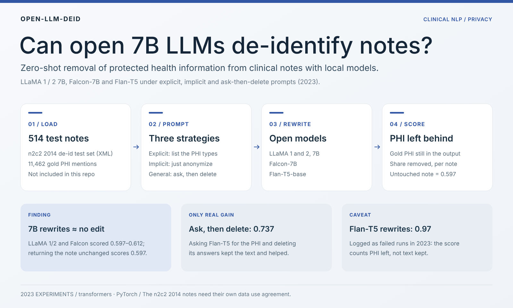

<div align="center">

# Open-LLM De-identification

**Can open 7B language models strip protected health information from clinical notes, zero-shot?**


-6E7781)
[](https://arxiv.org/abs/2303.11032)
[](https://www.ccao2679.com/research/#deid)



</div>

<!-- problem-framing:start -->

## Problem and evidence

> **With the same clinical text and model budget, do explicit de-identification instructions miss fewer sensitive entities than general instructions, while keeping non-sensitive content intact?**

**Why it matters:** A missed entity can expose personal information, while over-deletion destroys the text's research value. A single overall score cannot show the cost of either error.

**Central tension:** More detailed rules may raise coverage, but they may also delete ordinary words or change the meaning; rare names and contextual ambiguity let an average hide the weak spots.

[Full problem and verification plan](PROBLEM.md) · [中文](PROBLEM.zh.md)

<!-- problem-framing:end -->

## Findings

- **Setting.** The 514 notes of the 2014 i2b2/UTHealth (n2c2) de-identification test set, with 11,462 gold PHI mentions (names, professions, locations, ages, dates, contacts, IDs). The open models ran on local GPUs.
- **7B rewrites barely touched the PHI.** Asked to rewrite a note without PHI, LLaMA 1 7B, LLaMA 2 7B and Falcon-7B scored 0.597–0.612. Returning the note unchanged scores **0.597** under the same metric, so these runs removed almost nothing.
- **Asking, then deleting, worked better.** Asking Flan-T5-base for the names, dates and IDs in a note and deleting its answers from the text scored **0.737**, the only clear gain that also keeps the note intact.
- **A high score is not a good rewrite.** Flan-T5's rewrite runs scored 0.97, but the 2023 log marks them as failed runs: the metric counts PHI left behind, not text kept, so over-deletion looks like success. [PROBLEM.md](PROBLEM.md) sets out the evaluation that would settle this.

## Results

Share of gold PHI mentions no longer present in the output, averaged over the 514 notes (scripts: `Accuracy.py`).

| Model | Explicit prompt | Implicit prompt | General (ask, then delete) |
|---|---:|---:|---:|
| LLaMA 1 7B | 0.612 | 0.609 | 0.597 |
| LLaMA 2 7B | 0.612 | 0.609 | 0.597 |
| Falcon-7B | 0.605 | 0.603 | 0.597 |
| Flan-T5-base | 0.974† | 0.966† | **0.737** |
| *Note returned unchanged* | *0.597* | | |

† Logged as failed rewrites in the 2023 notes; the score does not check that the text survived.

**Reading the metric.** A PHI string counts as leaked when it appears as a whole word in the output, and each distinct string counts once however often it recurs, while the denominator counts every mention. Multi-word PHI such as an address never matches a single word. Together these let an untouched note score 0.597, so read every number against that floor. Precision values printed by the scripts are not meaningful and are left out.

## How it works

| Step | What happens | Scripts |
|---|---|---|
| 1. Load | Read each n2c2 XML note and its gold PHI tags | all generators (BeautifulSoup) |
| 2. Prompt | **Explicit**: the DeID-GPT-style instruction listing every PHI type to replace with `[redacted]`. **Implicit**: "Please anonymize the following text". **General**: ask one question per PHI type ("What are the names?", "What are dates?", …) and delete each answer from the note | `Explicit*.py`, `Implicit*.py`, `General*.py` |
| 3. Rewrite | Run LLaMA 1/2 7B, Falcon-7B or Flan-T5-base with 🤗 transformers on local GPUs; one output file per note | `Experiment1/`, `flan/`, `*_understand.py` (does the model know what "anonymize" means?) |
| 4. Score | Compare outputs with the gold tags and average the share of PHI removed | `Accuracy.py`, `deid-08*-output/Accuracy*.py` |

## Quick start

1. Request the **2014 i2b2/UTHealth de-identification** data through the n2c2 data portal (Harvard DBMI) and sign its data use agreement. Put the test-set XML files in `testing-PHI-Gold-fixed/`; the folder is git-ignored.
2. Install the dependencies and log in to Hugging Face for the gated LLaMA weights:

   ```bash
   pip install -r requirements.txt
   ```
3. Set `model` at the top of a generator and run it, for example `python3 Explicit2.py`; outputs go to `rewrite_<model>_explicit2/` (git-ignored).
4. Point `rewrite_directory` in `Accuracy.py` at that folder and run it for the averaged score.

## Data and privacy

This repository holds **no clinical text**. The n2c2 notes, every model rewrite of them and the sentence files extracted from them were removed from the whole git history in October 2026, and `.gitignore` keeps such files out. The n2c2 data use agreement does not allow redistribution, so bring your own licensed copy. The Kaggle Reddit/Twitter comment files under `llama2-10k-datase/kaggle_data/` are public data kept from the planned fine-tuning set.

## Repository layout

| Path | Purpose |
|---|---|
| `Explicit*.py`, `Implicit*.py`, `General*.py` | One generator per prompt style (local 🤗 models) |
| `*_understand.py`, `Understand_Test/` | Probe whether a model understands the instruction itself |
| `Experiment1/` | First runs with the `transformers` pipeline (Falcon, LLaMA 2, mT0 zero-shot NER) |
| `flan/` | Flan-T5 variants (sequence-to-sequence) |
| `Chat_API/` | The same explicit prompt through the ChatGPT API |
| `Accuracy.py`, `deid-08*-output/` | Scoring scripts and the score logs of the 21, 24 and 28 August 2023 runs |
| `llama2-10k-datase/` | Tools for a name-swapped sentence set planned for fine-tuning |
| `PROBLEM.md` | The research question and the evaluation that would settle it ([中文](PROBLEM.zh.md)) |

## Related

- Z. Liu, X. Yu, L. Zhang, Z. Wu, **C. Cao**, et al. *DeID-GPT: Zero-shot Medical Text De-Identification by GPT-4.* arXiv:2303.11032, 2023. The explicit prompt here follows its style; this repository asks the same question of open models that can run inside a hospital.

<details>
<summary>2023 lab notes (original README, partly in Chinese)</summary>

The data folders these notes mention are no longer in the repository.

## Models
 
LLaMA系列建议本地加载模型

1. LLaMA
   
   Convert model weights to HF format (HuggingFace): convert_llama_weights_to_hf.py

   非专业版本：
   ```python
   # Load model directly
    from transformers import AutoTokenizer, AutoModelForCausalLM

    tokenizer = AutoTokenizer.from_pretrained("openlm-research/open_llama_7b_v2")
    model = AutoModelForCausalLM.from_pretrained("openlm-research/open_llama_7b_v2")
    ```

2. LLaMA2
   (**meta-llama/Llama-2-7b**)

    Convert model weights to HF format (HuggingFace): convert_llama_weights_to_hf.py

    ```python
    # Load model directly
    from transformers import AutoTokenizer, AutoModelForCausalLM

    tokenizer = AutoTokenizer.from_pretrained("meta-llama/Llama-2-7b-hf")
    model = AutoModelForCausalLM.from_pretrained("meta-llama/Llama-2-7b-hf")
    ```
3. Falcon-7b
   (**tiiuae/falcon-7b**)

   ```python
   # Load model directly
    from transformers import AutoModelForCausalLM
    model = AutoModelForCausalLM.from_pretrained("tiiuae/falcon-7b", trust_remote_code=True)
    ```

4. Flan-t5
   (**google/flan-t5-base**) 
   
   **There are multiple versions for flan-t5 models.**

   **flan-t5是AutoModelForSeq2SeqLM**
   
   **falcon-7b是AutoModelForCausalLM**

   ```python
   # Load model directly
    from transformers import AutoTokenizer, AutoModelForSeq2SeqLM

    tokenizer = AutoTokenizer.from_pretrained("google/flan-t5-base")
    model = AutoModelForSeq2SeqLM.from_pretrained("google/flan-t5-base")
    ```

    ```python
    # pip install accelerate
    from transformers import T5Tokenizer, T5ForConditionalGeneration

    tokenizer = T5Tokenizer.from_pretrained("google/flan-t5-base")
    model = T5ForConditionalGeneration.from_pretrained("google/flan-t5-base", device_map="auto")

    input_text = "translate English to German: How old are you?"
    input_ids = tokenizer(input_text, return_tensors="pt").input_ids.to("cuda")

    outputs = model.generate(input_ids)
    print(tokenizer.decode(outputs[0]))
    ```


## Dataset

### Original Dataset
**testing-PHI-Gold-fixed** folder contains xml files

### Finetune
1. sentences_nornal.csv
2. sentences_random.csv

extracted from testing-PHI-Gold-fixed folder

Total number of occurrences of the word 'he' in sentences_he_she.csv: 3456

Total number of occurrences of the word 'she' in sentences_he_she.csv: 2237

- Diiference

replaced with some wired/rare names 

Replaced with 300 normal names

## Paramaters

### HuggingFace Models

```python
# Load falcon-7b model
#
input_directory = './testing-PHI-Gold-fixed'
model = "tiiuae/falcon-7b"
# model = "google/flan-t5-base"
model_name_part = model.split("/")[-1]
output_path = "./rewrite_{}_implicit".format(model_name_part)
# 修改以上model和input_directory
```
**flan-t5是AutoModelForSeq2SeqLM**

**falcon-7b是AutoModelForCausalLM**

### Local Models
```python
# Load Local model
#
input_directory = './testing-PHI-Gold-fixed'
model = "LLaMA1_7B"
# model = "LLaMA2_7B"
model_name_part = model
output_path = "./rewrite_{}_implicit".format(model_name_part)

# 修改以上model和input_directory
```

## Prompts

输入到messages的content里的内容

# Explicit

    prompt = "Please anonymize the following clinical note. Specifically, replace all the following information with the term “[redacted]”: redact any strings that might be a name or acronym or initial, redact any strings separated by the \/ symbol, redact patients' names, doctors' names and the strings in front of M.D. or after Dr., redact pager names and medical staff names, redact any strings that look like something years old or age 37, redact any dates and IDs and numbers and record dates, redact locations and addresses and clinic names, redact professions and ages and contacts, redact any acronyms and initials.: \n" + list_of_text_contents[i]  

# Implicit

    prompt = "Please anonymize the following text: \n" + list_of_text_contents[i]  

---

### General 

```python
# iterate over files in the source directory
for filename in tqdm(sorted(os.listdir(source_dir))):
    # checking if it is a file
    if os.path.isfile(os.path.join(source_dir, filename)):
        print("Processing file:", filename)
        # load the XML file
        with open(os.path.join(source_dir, filename), 'r') as f:
            soup = BeautifulSoup(f, features="xml")
            # extract the text content
            text = soup.find('TEXT').text
            # extract the answers to the 7 questions
            result1 = qamt0.extract(text, "What are the names?", iterate=True)
            result2 = qamt0.extract(text, "Who are the professions?", iterate=True)
            result3 = qamt0.extract(text, "What are the locations?", iterate=True)
            result4 = qamt0.extract(text, "What are ages?", iterate=True)
            result5 = qamt0.extract(text, "What are dates?", iterate=True)
            result6 = qamt0.extract(text, "What are contacts?", iterate=True)
            result7 = qamt0.extract(text, "What are IDs?", iterate=True)
            result8 = qamt0.extract(text, "What are the phone numbers?", iterate=True)
            # replace the matching characters with [redacted]
            for result in [result1, result2, result3, result4, result5, result6, result7, result8]:
                for r in result:
                    # print(r)
                    if '(' or ')' in r:
                      text = text.replace(r, '[redacted]')
                    else:
                      pattern = r'\b{}\b'.format(r)
                      text = re.sub(pattern, '[redacted]', text)
```
## Experiment
### Experiment1
```python
pipeline = transformers.pipeline(
    "text-generation",
    model=model,
    tokenizer=tokenizer,
    torch_dtype=torch.bfloat16,
    trust_remote_code=True,
    device_map="auto",
)
```

### Experiment2
```python
# Load model directly
from transformers import AutoTokenizer, AutoModelForCausalLM

tokenizer = AutoTokenizer.from_pretrained("meta-llama/Llama-2-7b-hf")
model = AutoModelForCausalLM.from_pretrained("meta-llama/Llama-2-7b-hf")
```

## Error
1. 
model = "meta-llama/Llama-2-7b-hf"

https://huggingface.co/meta-llama/Llama-2-7b-hf

This one does not work.

2. Flan-t5

```shell
/media/c/sdd/Deid | main !1 ?3  python3 Explicit2.py
Traceback (most recent call last):
  File "/media/ccao0366/sdd/Deid/Explicit2.py", line 34, in <module>
    model = AutoModelForCausalLM.from_pretrained(model,trust_remote_code=True).to("cuda")
  File "/home/ccao0366/.local/lib/python3.10/site-packages/transformers/models/auto/auto_factory.py", line 470, in from_pretrained
    raise ValueError(
ValueError: Unrecognized configuration class <class 'transformers.models.t5.configuration_t5.T5Config'> for this kind of AutoModel: AutoModelForCausalLM.
Model type should be one of BartConfig, BertConfig, BertGenerationConfig, BigBirdConfig, BigBirdPegasusConfig, BioGptConfig, BlenderbotConfig, BlenderbotSmallConfig, BloomConfig, CamembertConfig, CodeGenConfig, CpmAntConfig, CTRLConfig, Data2VecTextConfig, ElectraConfig, ErnieConfig, GitConfig, GPT2Config, GPT2Config, GPTBigCodeConfig, GPTNeoConfig, GPTNeoXConfig, GPTNeoXJapaneseConfig, GPTJConfig, LlamaConfig, MarianConfig, MBartConfig, MegaConfig, MegatronBertConfig, MvpConfig, OpenLlamaConfig, OpenAIGPTConfig, OPTConfig, PegasusConfig, PLBartConfig, ProphetNetConfig, QDQBertConfig, ReformerConfig, RemBertConfig, RobertaConfig, RobertaPreLayerNormConfig, RoCBertConfig, RoFormerConfig, RwkvConfig, Speech2Text2Config, TransfoXLConfig, TrOCRConfig, XGLMConfig, XLMConfig, XLMProphetNetConfig, XLMRobertaConfig, XLMRobertaXLConfig, XLNetConfig, XmodConfig.
```

Solution:

```python
from transformers import AutoModelForSeq2SeqLM, AutoTokenizer

model = AutoModelForSeq2SeqLM.from_pretrained("google/flan-t5-small")
tokenizer = AutoTokenizer.from_pretrained("google/flan-t5-small")

inputs = tokenizer("A step by step recipe to make bolognese pasta:", return_tensors="pt")
outputs = model.generate(**inputs)
print(tokenizer.batch_decode(outputs, skip_special_tokens=True))
```

---
# Result Table

||Falcon-7B|Flan-t5-base|LLaMA1_7B|LLaMA2_7B|
|-|-|-|-|-|
|explicit|0.605|NA|0.612|0.612|
|implicit|0.603|NA|0.609|0.609|
|general|0.597|0.737|0.597||

**注意：**

Flan-t5-base在explicit和implicit表现不佳

# To Do
- [x] LLaMA模型需要进行验证 -0824
- [ ] LLaMA1和2在deid方面的表现差异很小

</details>
