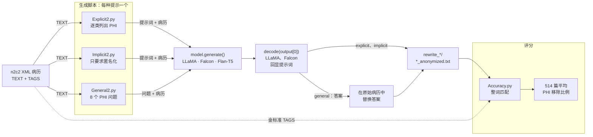

<div align="center">

# Open-LLM De-identification

[English](README.md) · **简体中文**

**开源 7B 语言模型能否在零样本条件下，去除临床病历中的受保护健康信息（PHI）？**


-6E7781)
[](https://arxiv.org/abs/2303.11032)
[](https://www.ccao2679.com/research/#deid)


</div>

<!-- problem-framing:start -->

## 问题与依据

> **在相同临床文本与模型预算下，显式脱敏指令是否比泛化指令更少遗漏敏感实体，同时保留非敏感内容？**

**为什么值得解决：** 漏删可能暴露个人信息，过度删除则损害文本的研究价值。仅报告一个总体分数，无法说明这两种错误各自的代价。

**核心矛盾：** 更详细的规则可能提高覆盖率，也可能误删普通词语或改变原意；少见姓名和上下文歧义会让平均分掩盖薄弱环节。

[完整问题与验证方案](PROBLEM.zh.md) · [English](PROBLEM.md)

<!-- problem-framing:end -->

## 主要发现

- **实验设置。** 使用 2014 年 i2b2/UTHealth（n2c2）去标识化测试集的 514 篇病历，共 11,462 处金标准 PHI 提及（姓名、职业、地点、年龄、日期、联系方式、ID）。开源模型在本地 GPU 上运行。[`examples/`](examples/) 中的一篇合成病历演示了每一步，不需要受限数据。
- **2023 年的改写分数衡量的是流程，而不是模型。** 生成脚本保存的是 `tokenizer.decode(output[0])`。对 LLaMA 和 Falcon 来说，这段序列以提示词开头，而提示词里包含整篇病历，所以每个 PHI 字符串都还留在保存的文件里，分数（0.597–0.612）落在未改动病历的下限（0.597）上。Flan-T5 是序列到序列模型，只返回新生成的文本，但 `generate()` 调用时没有设置长度，于是停在库默认的 20 个 token，只剩病历的一个片段，反而得到 0.97 分。
- **唯一可用的数字：先问后删。** 针对每类 PHI 向 Flan-T5-base 提一个问题，再把它的回答在原始病历中替换掉，得分 **0.737**（下限为 0.597），病历的其余部分保持不变。
- **重跑需要什么。** 只保存新生成的 token（`output[0][inputs.shape[1]:]`），把 `max_new_tokens` 设到足以覆盖整篇病历，对话模型使用 chat template，并在 PHI 移除率之外同时评估过度删除和文本保真度，具体见 [PROBLEM.zh.md](PROBLEM.zh.md)。

## 结果

保存的输出中已不再出现的金标准 PHI 提及所占比例，在 514 篇病历上取平均（`Accuracy.py`）。

| 模型 | Explicit 提示 | Implicit 提示 | General（先问后删） |
|---|---:|---:|---:|
| LLaMA 1 7B | 0.612\* | 0.609\* | 0.597\* |
| LLaMA 2 7B | 0.612\* | 0.609\* | 0.597\* |
| Falcon-7B | 0.605\* | 0.603\* | 0.597\* |
| Flan-T5-base | 0.974† | 0.966† | **0.737** |
| *原样返回病历* | *0.597* | | |

\* 解码输出以提示词开头，而提示词包含病历：改写文件里保留着整篇病历；在 general 运行中，“答案”永远与病历对不上，因此什么也没有被替换。† 输出在默认的 20 个 token 处被截断，只剩一个片段，因而被算作已移除。

**如何解读该指标。** 一个 PHI 字符串只要以完整单词的形式出现在输出中，就计为泄漏；每个不同的字符串无论重复多少次都只计一次，而分母统计的是全部提及。地址这类多词 PHI 永远无法与单个词匹配。这几点叠加起来，让未改动的病历也能得到 0.597，所以每个数字都要对照这个下限来看；[`examples/score_example.py`](examples/score_example.py) 在合成病历上演示了同样的效应。脚本打印的 Precision 值没有意义，因此未列出。

## 架构



从左往右看：每个生成脚本把病历包进各自的提示词，`decode(output[0])` 返回的文本要么原样保存（explicit、implicit），要么被拆成答案、再在病历中替换掉（general）。对 LLaMA 和 Falcon，这段解码文本以提示词开头，所以每个保存的文件里仍有全部 PHI 字符串；`flan/` 中的副本用 Flan-T5 跑同样的三条路径。

## 工作原理

| 步骤 | 做什么 | 脚本 |
|---|---|---|
| 1. 加载 | 读取每篇 n2c2 XML 病历及其金标准 PHI 标签 | 所有生成脚本（BeautifulSoup） |
| 2. 提示 | **Explicit**：DeID-GPT 风格的指令，列出所有需要替换为 `[redacted]` 的 PHI 类型。**Implicit**：“Please anonymize the following text”。**General**：每类 PHI 提一个问题（“What are the names?”、“What are dates?”……），再把每个答案从病历中删除 | `Explicit*.py`、`Implicit*.py`、`General*.py` |
| 3. 改写 | 用 🤗 transformers 在本地 GPU 上运行 LLaMA 1/2 7B、Falcon-7B 或 Flan-T5-base；每篇病历一个输出文件 | `Experiment1/`、`flan/`、`*_understand.py`（模型是否理解 “anonymize” 的含义？） |
| 4. 评分 | 将输出与金标准标签比较，对 PHI 移除比例取平均 | `Accuracy.py`、`deid-08*-output/Accuracy*.py` |

## 快速开始

1. 通过 n2c2 数据门户（Harvard DBMI）申请 **2014 i2b2/UTHealth de-identification** 数据，并签署其数据使用协议。把测试集的 XML 文件放进 `testing-PHI-Gold-fixed/`；该文件夹已被 git 忽略。
2. 安装依赖，并登录 Hugging Face 以获取需要授权的 LLaMA 权重：

   ```bash
   pip install -r requirements.txt
   ```
3. 在生成脚本顶部设置 `model` 后运行，例如 `python3 Explicit2.py`；输出写入 `rewrite_<model>_explicit2/`（已被 git 忽略）。
4. 把 `Accuracy.py` 中的 `rewrite_directory` 指向该文件夹并运行，得到平均分数。

## 数据与隐私

本仓库**不含任何临床文本**；`examples/` 中的病历是合成的。n2c2 病历、模型对它们的所有改写，以及从中抽取的句子文件，已于 2026 年 10 月从整个 git 历史中移除，`.gitignore` 也会把这类文件挡在仓库之外。n2c2 数据使用协议不允许再分发，请使用你自己获得授权的副本。`llama2-10k-datase/kaggle_data/` 下的 Kaggle Reddit/Twitter 评论文件是公开数据，保留自原计划的微调数据集。

## 目录结构

| 路径 | 用途 |
|---|---|
| `Explicit*.py`、`Implicit*.py`、`General*.py` | 每种提示风格一个生成脚本（本地 🤗 模型） |
| `examples/` | n2c2 格式的合成病历、每种提示的输入、期望输出，以及可以直接运行的评分脚本 |
| `*_understand.py`、`Understand_Test/` | 检验模型是否理解指令本身 |
| `Experiment1/` | 最早用 `transformers` pipeline 跑的实验（Falcon、LLaMA 2、mT0 零样本 NER） |
| `flan/` | Flan-T5 版本（序列到序列） |
| `Chat_API/` | 通过 ChatGPT API 运行同一条 explicit 提示 |
| `Accuracy.py`、`deid-08*-output/` | 评分脚本，以及 2023 年 8 月 21、24、28 日各次运行的评分日志 |
| `llama2-10k-datase/` | 为计划中的微调构建姓名替换句子集的工具 |
| `PROBLEM.zh.md` | 研究问题，以及能够回答它的评测方案（[English](PROBLEM.md)） |

## 相关论文

- Z. Liu, X. Yu, L. Zhang, Z. Wu, **C. Cao**, et al. *DeID-GPT: Zero-shot Medical Text De-Identification by GPT-4.* arXiv:2303.11032, 2023. 本仓库的 explicit 提示沿用了它的风格；这里把同一个问题交给能够在医院内部运行的开源模型。

<details>
<summary>2023 年实验笔记（原 README，部分为中文）</summary>

这些笔记中提到的数据文件夹已不在仓库中。

## Models
 
LLaMA系列建议本地加载模型

1. LLaMA
   
   Convert model weights to HF format (HuggingFace): convert_llama_weights_to_hf.py

   非专业版本：
   ```python
   # Load model directly
    from transformers import AutoTokenizer, AutoModelForCausalLM

    tokenizer = AutoTokenizer.from_pretrained("openlm-research/open_llama_7b_v2")
    model = AutoModelForCausalLM.from_pretrained("openlm-research/open_llama_7b_v2")
    ```

2. LLaMA2
   (**meta-llama/Llama-2-7b**)

    Convert model weights to HF format (HuggingFace): convert_llama_weights_to_hf.py

    ```python
    # Load model directly
    from transformers import AutoTokenizer, AutoModelForCausalLM

    tokenizer = AutoTokenizer.from_pretrained("meta-llama/Llama-2-7b-hf")
    model = AutoModelForCausalLM.from_pretrained("meta-llama/Llama-2-7b-hf")
    ```
3. Falcon-7b
   (**tiiuae/falcon-7b**)

   ```python
   # Load model directly
    from transformers import AutoModelForCausalLM
    model = AutoModelForCausalLM.from_pretrained("tiiuae/falcon-7b", trust_remote_code=True)
    ```

4. Flan-t5
   (**google/flan-t5-base**) 
   
   **There are multiple versions for flan-t5 models.**

   **flan-t5是AutoModelForSeq2SeqLM**
   
   **falcon-7b是AutoModelForCausalLM**

   ```python
   # Load model directly
    from transformers import AutoTokenizer, AutoModelForSeq2SeqLM

    tokenizer = AutoTokenizer.from_pretrained("google/flan-t5-base")
    model = AutoModelForSeq2SeqLM.from_pretrained("google/flan-t5-base")
    ```

    ```python
    # pip install accelerate
    from transformers import T5Tokenizer, T5ForConditionalGeneration

    tokenizer = T5Tokenizer.from_pretrained("google/flan-t5-base")
    model = T5ForConditionalGeneration.from_pretrained("google/flan-t5-base", device_map="auto")

    input_text = "translate English to German: How old are you?"
    input_ids = tokenizer(input_text, return_tensors="pt").input_ids.to("cuda")

    outputs = model.generate(input_ids)
    print(tokenizer.decode(outputs[0]))
    ```


## Dataset

### Original Dataset
**testing-PHI-Gold-fixed** folder contains xml files

### Finetune
1. sentences_nornal.csv
2. sentences_random.csv

extracted from testing-PHI-Gold-fixed folder

Total number of occurrences of the word 'he' in sentences_he_she.csv: 3456

Total number of occurrences of the word 'she' in sentences_he_she.csv: 2237

- Diiference

replaced with some wired/rare names 

Replaced with 300 normal names

## Paramaters

### HuggingFace Models

```python
# Load falcon-7b model
#
input_directory = './testing-PHI-Gold-fixed'
model = "tiiuae/falcon-7b"
# model = "google/flan-t5-base"
model_name_part = model.split("/")[-1]
output_path = "./rewrite_{}_implicit".format(model_name_part)
# 修改以上model和input_directory
```
**flan-t5是AutoModelForSeq2SeqLM**

**falcon-7b是AutoModelForCausalLM**

### Local Models
```python
# Load Local model
#
input_directory = './testing-PHI-Gold-fixed'
model = "LLaMA1_7B"
# model = "LLaMA2_7B"
model_name_part = model
output_path = "./rewrite_{}_implicit".format(model_name_part)

# 修改以上model和input_directory
```

## Prompts

输入到messages的content里的内容

# Explicit

    prompt = "Please anonymize the following clinical note. Specifically, replace all the following information with the term “[redacted]”: redact any strings that might be a name or acronym or initial, redact any strings separated by the \/ symbol, redact patients' names, doctors' names and the strings in front of M.D. or after Dr., redact pager names and medical staff names, redact any strings that look like something years old or age 37, redact any dates and IDs and numbers and record dates, redact locations and addresses and clinic names, redact professions and ages and contacts, redact any acronyms and initials.: \n" + list_of_text_contents[i]  

# Implicit

    prompt = "Please anonymize the following text: \n" + list_of_text_contents[i]  

---

### General 

```python
# iterate over files in the source directory
for filename in tqdm(sorted(os.listdir(source_dir))):
    # checking if it is a file
    if os.path.isfile(os.path.join(source_dir, filename)):
        print("Processing file:", filename)
        # load the XML file
        with open(os.path.join(source_dir, filename), 'r') as f:
            soup = BeautifulSoup(f, features="xml")
            # extract the text content
            text = soup.find('TEXT').text
            # extract the answers to the 7 questions
            result1 = qamt0.extract(text, "What are the names?", iterate=True)
            result2 = qamt0.extract(text, "Who are the professions?", iterate=True)
            result3 = qamt0.extract(text, "What are the locations?", iterate=True)
            result4 = qamt0.extract(text, "What are ages?", iterate=True)
            result5 = qamt0.extract(text, "What are dates?", iterate=True)
            result6 = qamt0.extract(text, "What are contacts?", iterate=True)
            result7 = qamt0.extract(text, "What are IDs?", iterate=True)
            result8 = qamt0.extract(text, "What are the phone numbers?", iterate=True)
            # replace the matching characters with [redacted]
            for result in [result1, result2, result3, result4, result5, result6, result7, result8]:
                for r in result:
                    # print(r)
                    if '(' or ')' in r:
                      text = text.replace(r, '[redacted]')
                    else:
                      pattern = r'\b{}\b'.format(r)
                      text = re.sub(pattern, '[redacted]', text)
```
## Experiment
### Experiment1
```python
pipeline = transformers.pipeline(
    "text-generation",
    model=model,
    tokenizer=tokenizer,
    torch_dtype=torch.bfloat16,
    trust_remote_code=True,
    device_map="auto",
)
```

### Experiment2
```python
# Load model directly
from transformers import AutoTokenizer, AutoModelForCausalLM

tokenizer = AutoTokenizer.from_pretrained("meta-llama/Llama-2-7b-hf")
model = AutoModelForCausalLM.from_pretrained("meta-llama/Llama-2-7b-hf")
```

## Error
1. 
model = "meta-llama/Llama-2-7b-hf"

https://huggingface.co/meta-llama/Llama-2-7b-hf

This one does not work.

2. Flan-t5

```shell
/media/c/sdd/Deid | main !1 ?3  python3 Explicit2.py
Traceback (most recent call last):
  File "/media/ccao0366/sdd/Deid/Explicit2.py", line 34, in <module>
    model = AutoModelForCausalLM.from_pretrained(model,trust_remote_code=True).to("cuda")
  File "/home/ccao0366/.local/lib/python3.10/site-packages/transformers/models/auto/auto_factory.py", line 470, in from_pretrained
    raise ValueError(
ValueError: Unrecognized configuration class <class 'transformers.models.t5.configuration_t5.T5Config'> for this kind of AutoModel: AutoModelForCausalLM.
Model type should be one of BartConfig, BertConfig, BertGenerationConfig, BigBirdConfig, BigBirdPegasusConfig, BioGptConfig, BlenderbotConfig, BlenderbotSmallConfig, BloomConfig, CamembertConfig, CodeGenConfig, CpmAntConfig, CTRLConfig, Data2VecTextConfig, ElectraConfig, ErnieConfig, GitConfig, GPT2Config, GPT2Config, GPTBigCodeConfig, GPTNeoConfig, GPTNeoXConfig, GPTNeoXJapaneseConfig, GPTJConfig, LlamaConfig, MarianConfig, MBartConfig, MegaConfig, MegatronBertConfig, MvpConfig, OpenLlamaConfig, OpenAIGPTConfig, OPTConfig, PegasusConfig, PLBartConfig, ProphetNetConfig, QDQBertConfig, ReformerConfig, RemBertConfig, RobertaConfig, RobertaPreLayerNormConfig, RoCBertConfig, RoFormerConfig, RwkvConfig, Speech2Text2Config, TransfoXLConfig, TrOCRConfig, XGLMConfig, XLMConfig, XLMProphetNetConfig, XLMRobertaConfig, XLMRobertaXLConfig, XLNetConfig, XmodConfig.
```

Solution:

```python
from transformers import AutoModelForSeq2SeqLM, AutoTokenizer

model = AutoModelForSeq2SeqLM.from_pretrained("google/flan-t5-small")
tokenizer = AutoTokenizer.from_pretrained("google/flan-t5-small")

inputs = tokenizer("A step by step recipe to make bolognese pasta:", return_tensors="pt")
outputs = model.generate(**inputs)
print(tokenizer.batch_decode(outputs, skip_special_tokens=True))
```

---
# Result Table

||Falcon-7B|Flan-t5-base|LLaMA1_7B|LLaMA2_7B|
|-|-|-|-|-|
|explicit|0.605|NA|0.612|0.612|
|implicit|0.603|NA|0.609|0.609|
|general|0.597|0.737|0.597||

**注意：**

Flan-t5-base在explicit和implicit表现不佳

# To Do
- [x] LLaMA模型需要进行验证 -0824
- [ ] LLaMA1和2在deid方面的表现差异很小

</details>
